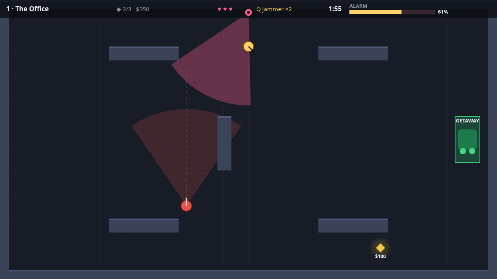
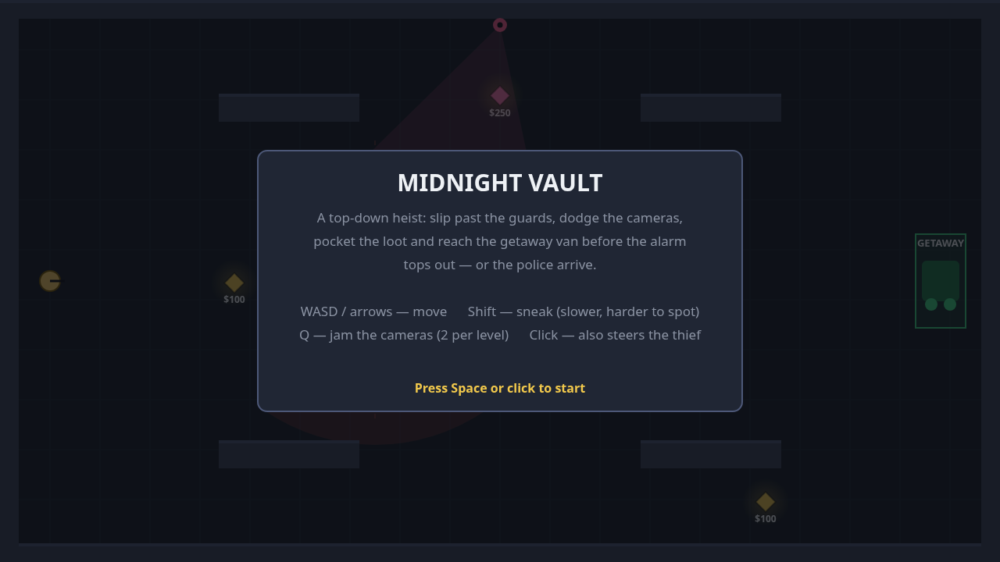

# Midnight Vault — a top-down heist game

**Midnight Vault** is a top-down stealth heist game, built for the
[make.fun "Make the best heist game" competition](https://make.fun/c/best-heist-game-20261122-0559).
One thief, three jobs — an office, a museum, a bank vault — and one getaway van.

## How it plays

- **Infiltrate.** Slip past patrolling guards and their vision cones, and the
  sweeping CCTV cameras. Walls block sight, so use them as cover.
- **Steal.** Pocket the loot: cash ($100), paintings ($250), diamonds ($500),
  vault gold ($1,000). The van only leaves with at least one piece aboard.
- **Don't get seen.** Being spotted fills the alarm meter; a full alarm locks
  the building down, costs $100, and sends every guard hunting for you.
- **Escape.** Reach the getaway van before the clock runs out. Score is loot
  plus a time bonus, minus lockdown penalties.

## Controls

| Key | Action |
| --- | --- |
| WASD / arrow keys | Move (hold the mouse button to steer instead) |
| Shift | Sneak — slower, but half as easy to spot |
| Q | Jam the cameras for 8 seconds (2 charges per level) |
| P / Esc | Pause |
| M | Mute |
| Space / click | Confirm on menus |

## Play it

No build step, no network: open `game/index.html` in a desktop browser, or serve
it locally with `node serve.ts` and visit <http://localhost:8080>.

## Screenshots

## Build

`node main.ts` copies `game/` and `screenshots/` to the output directory and
writes `dossier.json` there (`MAKEFUN_OUTPUT_DIR` stands in for `/output`
outside the grader).

## Layout

- `game/index.html` — the page; `game/src/main.js` — the loop and screens.
- `game/src/world.js` — the rules: thief, guards, cameras, loot, alarm, score.
- `game/src/levels.js` — the three rooms. `game/src/render.js` — all drawing.
- `game/src/input.js` — keyboard + pointer. `game/src/audio.js` — WebAudio blips.
- `game/src/shots.js` — the staged screenshot scenes (a cone-aware autopilot
  plays the game for real) and `shots.json` lists the four captures.
- `main.ts` — the build script. `serve.ts` — the local static server.

## License

MIT — see [LICENSE](LICENSE).
