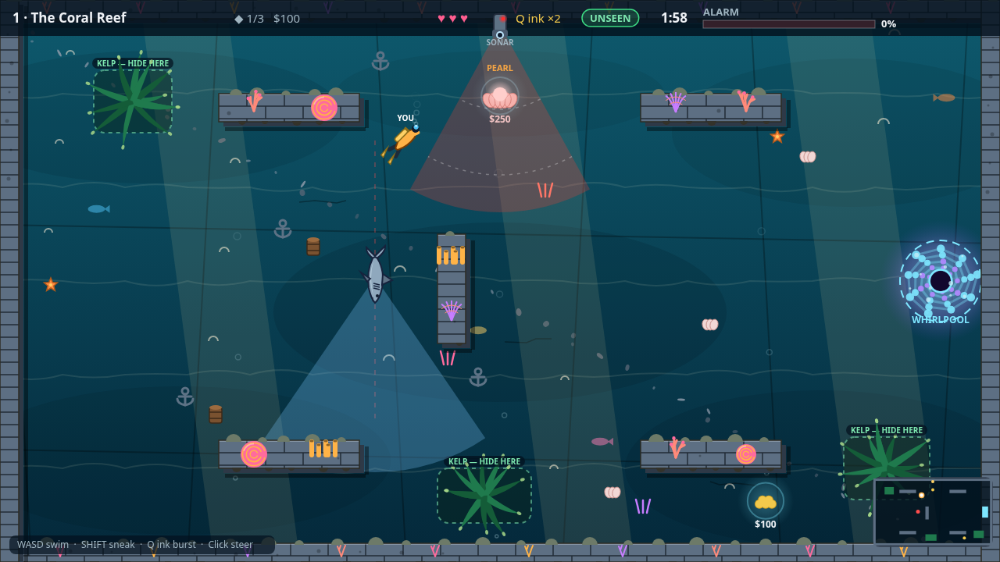
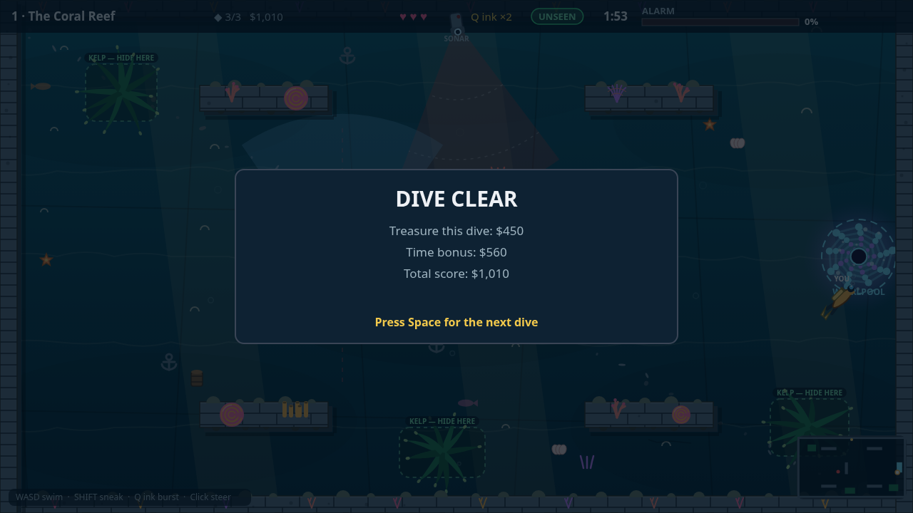

# Sunken Vault — an underwater heist game

**Sunken Vault** is an underwater stealth heist game, built for the
[make.fun "Make the best heist game" competition](https://make.fun/c/best-heist-game-20261122-0559).
One diver, three dives — a coral reef, a shipwreck, a deep trench — and one whirlpool
portal spinning at the far edge, waiting to carry the loot to another dimension.

## How it plays

- **Dive in.** Swim past patrolling sharks and their sense cones, and the
  sweeping sonar cameras hung on the walls. Stone-block walls block sight,
  so use them as cover — and hide in the kelp beds, which sharks and sonar
  cannot see through. The dashed patrol lines show where each shark swims,
  so you can guess its next move. A minimap in the corner shows the whole
  dive site — walls, kelp, treasure, sharks, sonar cameras and you.
- **Steal.** Pocket the sunken treasure: gold coins ($100), pearls ($250),
  sapphires ($500), treasure chests ($1,000). The whirlpool only takes you with at least
  one piece aboard.
- **Don't get seen.** Being spotted fills the alarm meter; a full alarm puts the
  whole reef on alert, costs $100, and sends every shark hunting for you.
- **Escape.** Reach the whirlpool before your air runs out. Score is treasure
  plus a time bonus, minus lockdown penalties.

## Controls

| Key | Action |
| --- | --- |
| WASD / arrow keys | Swim (hold the mouse button to steer instead) |
| Shift | Slow swim — slower, but half as easy to spot |
| Q | Ink burst, blinds the sonar cameras for 8 seconds (2 charges per dive) |
| P / Esc | Pause |
| M | Mute |
| Space / click | Confirm on menus |

## Play it

No build step, no network: open `game/index.html` in a desktop browser, or serve
it locally with `node serve.ts` and visit <http://localhost:8080>.

## Screenshots

## Build

`node main.ts` copies `game/` and `screenshots/` to the output directory and
writes `dossier.json` there (`MAKEFUN_OUTPUT_DIR` stands in for `/output`
outside the grader).

## Layout

- `game/index.html` — the page; `game/src/main.js` — the loop and screens.
- `game/src/world.js` — the rules: diver, sharks, sonar cameras, kelp, treasure, alarm, score.
- `game/src/levels.js` — the three dive sites. `game/src/render.js` — all drawing, hand-drawn in canvas.
- `game/src/input.js` — keyboard + pointer. `game/src/audio.js` — WebAudio blips.
- `game/src/shots.js` — the staged screenshot scenes (a cone-aware autopilot
  plays the game for real) and `shots.json` lists the four captures.
- `main.ts` — the build script. `serve.ts` — the local static server.

## License

MIT — see [LICENSE](LICENSE).
